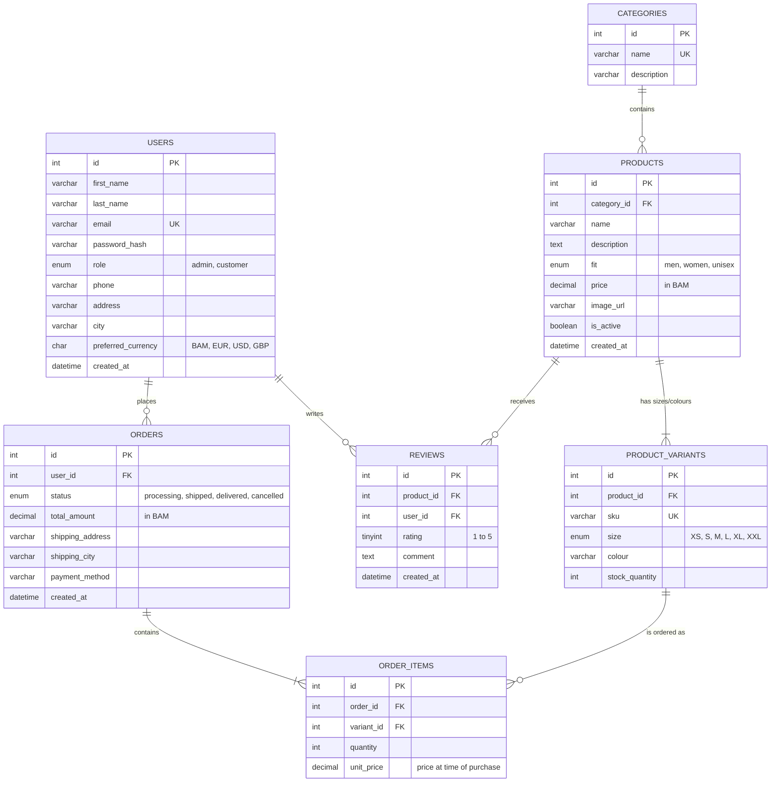

# Tracksuit Couture: draft ERD (Milestone 1)

GitHub renders the diagram below automatically.

## Entities and relationships

| Entity | Purpose | Relationships |
|---|---|---|
| **users** | Customers and admins | 1 user : N orders, 1 user : N reviews |
| **categories** | Velour, Retro, Lounge, Performance | 1 category : N products |
| **products** | A tracksuit model (name, price, description) | N products : 1 category, 1 product : N variants, 1 product : N reviews |
| **product_variants** | A sellable size + colour of a product, with its own stock | N variants : 1 product, 1 variant : N order items |
| **orders** | A placed order | N orders : 1 user, 1 order : N order items |
| **order_items** | One line of an order (variant, quantity, price) | N items : 1 order, N items : 1 variant |
| **reviews** | Rating and comment for a product | N reviews : 1 product, N reviews : 1 user |

## Design notes

- **Why variants?** One tracksuit comes in many sizes and colours, and stock is tracked per size and colour. Orders point to the variant, so we know exactly what was bought.
- **`order_items.unit_price`** stores the price at the moment of purchase, so changing a product price later does not change old orders.
- **Prices are stored in BAM.** Other currencies are calculated live using the external API (Frankfurter) and are never stored.
- **Cart** is kept on the frontend (localStorage) until checkout, so it is not a database table.
- **Roles:** `admin` (full CRUD on all entities) and `customer` (browse, order, review, manage own profile).
